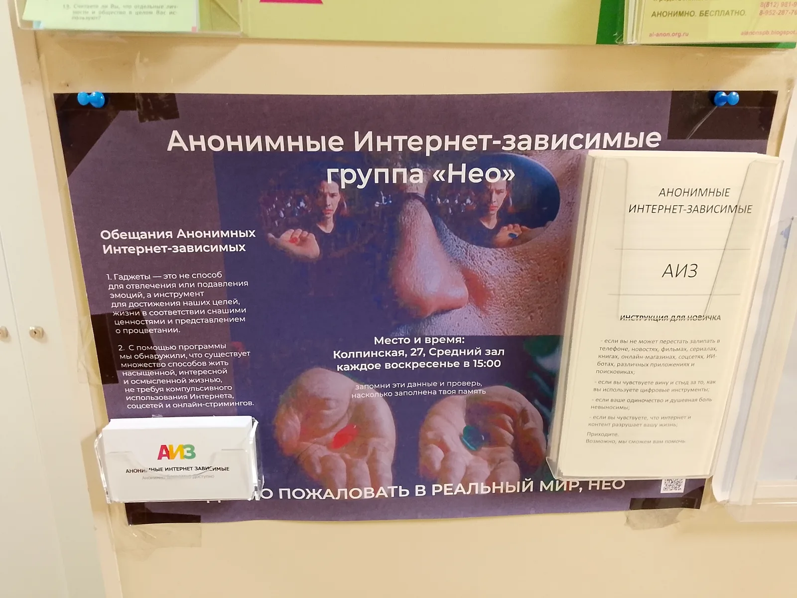

Здесь написан опыт несения вести в группе Санкт-Петербурга.

Интернет-зависимые — молодое и небольшое сообщество. Каждая группа по традициям АИЗ должна быть независимой.

Мы использовали опыт Анонимных Алкоголиков, которые также 80 лет назад помогали другим зависимым, будучи малочисленными.

Духовный опыт выражен в книгах и спикерских. Спикерские АА можно найти [здесь](https://t.me/SPIKERvd/4/2247). Книги — [здесь](https://aarussia.ru/litra).

Программа 12 шагов — программа действий, «Вера без действий мертва». Нужно пробовать написанное и сказанное.

Так, в «Пособии по информированию общественности» указывается размещение печатной продукции и плакатов. В сообществе АИЗ нашлись визитки и брошюры московской группы. У нашей группы уже был плакат в центре, в котором она проводилась.

Мы решили на рабочем собрании установить плакат с визитками и брошюрами в других центрах. Я созвонился с заведующей одного из центров, рассказал о нашей группе, и мы договорились. Сейчас они поставлены в 2 (см. картинки).

Второе направление работы — сотрудничество с лечебными учреждениями.

Как и в прохождении программы, нужно пробовать. Я нашел в интернете 4 учреждения, предлагающие помощь зависимым от интернета. Помолился и пошел в регистратуру одного из медицинских учреждений, и мне сказали писать письмо на почту. Я испытывал страх и раздражение, но напоминал себе, что служение — залог выздоровления. Только если я буду бескорыстно помогать другим зависимым, я смогу сам оставаться трезвым. Печатная продукция сообщества интернет-зависимых предоставляет возможность узнать о нас людям, которые так же, как и я раньше: залипают на видеохостингах до 5 часов ночи, ничего не делают дома, расстраиваясь и жалея себя из-за новостей о том, что происходит за тысячи километров, играют в онлайн-игры, ломая режим сна.

Я написал туда и в 3 других учреждения и не получил ответа. «Глупо делать одно и то же в надежде на другой результат», — говорит программа, поэтому я позвонил по телефону в одно из них. Мы договорились о встрече с врачом отделения. Я пришел, передал контакты сообщества, и удалось передать визитки и брошюры группы. При запросе их будут давать посетителям.

Также у нашей группы есть экземпляр [рабочей тетради интернет-зависимых](/files/opyt-neseniya-vesti-oflajn/aiz-rabochaya-tetrad.pdf), переведенной из иностранного сообщества. Комитет по обслуживанию сообщества выделил нашей группе средства на докупку 5 книг, и я их распечатал.

Подчеркну, что самое главное в программе — это не впасть в ловушку эгоизма: ведь если я буду считать свое мнение правильным и надеяться на то, что все будет по моей воле, — я. Поэтому важно обсуждать с другими людьми все инициативы и уметь слушать их. Так, на собрании комитета мы коллективным разумом, в котором проявляется Высшая Сила, поставили задачу укрепления офлайн-групп в сообществе. Я узнал о существовании брошюр и в принципе их получил в электронном виде от представителя московского сообщества. Сам я бы не смог сделать это. Бог направлял меня, а я был его инструментом.

Нет единственно верного способа делать 12 шаг — я попробовал, и у меня что-то получилось. Точно так же, как и в других шагах программы. Можете попробовать и вы.

Павел, представитель группы интернет-зависимых в Санкт-Петербурге «Нео»

### Материалы для офлайн-группы АИЗ

- Визитка АИЗ: [pdf](/files/opyt-neseniya-vesti-oflajn/aiz-vizitka.pdf) / [png](/files/opyt-neseniya-vesti-oflajn/aiz-vizitka.png)
- Брошюра АИЗ: [pdf](/files/opyt-neseniya-vesti-oflajn/aiz-broshura.pdf) / [png](/files/opyt-neseniya-vesti-oflajn/aiz-broshura.png)
- Брошюра АИЗ для Санкт-Петербурга (с контактами группы): [pdf](/files/opyt-neseniya-vesti-oflajn/aiz-broshura-spb.pdf) / [png](/files/opyt-neseniya-vesti-oflajn/aiz-broshura-spb.png)
- Рабочая тетрадь: [pdf](/files/opyt-neseniya-vesti-oflajn/aiz-rabochaya-tetrad.pdf) / [png](/files/opyt-neseniya-vesti-oflajn/aiz-rabochaya-tetrad.png)
- [Преамбула группы в Санкт-Петербурге](/files/opyt-neseniya-vesti-oflajn/preambula-neo-spb.pdf)
